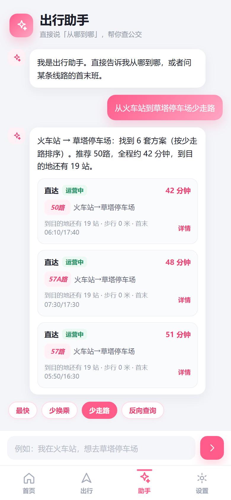
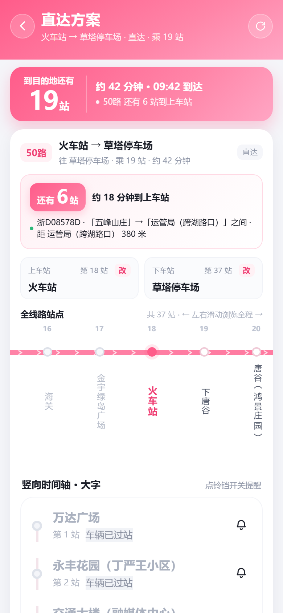

## 诸暨公交 · 长者易用版 v1.5.0

这一版做了三件事：**数据能自愈**、**能说话就出门**、**看方案少跳一层**。

### 1. 站点线路数据同步 + 降级自愈

不再靠「把 710 KB 快照打进包里」硬扛。现在带版本号增量同步，出错自己修：

| 机制 | 做法 |
|---|---|
| 版本清单 | `data/manifest.json` 记 `version / counts / totalHash / chunks[]` |
| 分片增量 | 8 个分片（每片 50 条线路，881 KB），片内 FNV-1a 32 位哈希；**哪片变了只下哪片** |
| 全量校准 | 启动 4 秒后一次、此后每 12 小时检查，**满 2 天**执行一次全量校准 |
| 自愈 | 分片哈希不符 → 只重下该片；整体哈希或条数不符 → 全量重取一次；版本回退以官方为准清缓存 |
| 官方不可用 | 直接用本地最后一份有效快照（`localStorage: zjbus.ds.v1`），**不弹窗、不红点、不公告** |
| 数据过期 | 快照 > 30 天 或 超过 7 天没成功检查 → 界面一行灰色小字提示，不打扰 |
| 联动刷新 | 数据一落地就 `ZJ.Data.rebuild()` 重建索引，首末班/收班校验、出行方案、详情页、线路页、站点页、首页**全部立刻用新数据重算** |

**实时车辆预估失效怎么办**：自动关掉「还有 N 站 / 约 M 分钟」这类到站预估字段，改为展示**起点发车时刻表**（`按时刻表乘车`）。线路页、站点页、详情页、竖向时间轴统一走这套降级文案，不会出现「拿过期车辆编数字」。

### 2. AI 智能体对话 Tab（新增）

底部第四个 Tab「助手」，说话就能查车：

- 输入「从西施殿公交首末站到草塔停车场」「23路末班几点」「火车站怎么去」，识别**起点 / 终点 / 线路 / 偏好**
- 返回一段文字总结 + **最多 3 张可点方案卡**（总时长、步行、线路串、车辆实时状态），点卡直接进换乘详情页
- 支持问首末班与收班状态：给运营时段、当前状态、最近班次、反向信息
- 快捷 chips：最快 / 少换乘 / 少走路 / 反向查询，一句话重排
- 复用同一套规划引擎与同一套数据降级逻辑，**无系统推送、无公告**

> 说明：这一版**不依赖任何云端模型密钥**，用本地确定性语义解析（词表 + 站点长名优先 + 重叠区间跳过）实现同等交互。未来接大模型只需替换 `www/js/ai.js` 的 `parse()`，其余 UI 与规划链路不用动。

### 3. 出行链路精简：一层到位

原来的「列表 → 详情 → 再进线路页」三层跳转砍掉一层：

```
出行页（起终点）→ 换乘方案列表页 → 换乘详情页 ──┬─→ 独立线路页（次要入口）
                                                └─→ 站点选择弹窗（就地改站，不跳页）
```

- **列表页卡片精简**：`方案 N · 直达/换乘 · 推荐/末班车已发出` + 大字 `42 分钟` + 线路串 + `步行 320 米 · 8.6 公里` + 车辆实时状态（`50路 还有 1 站`）。**列表页不再展开分段、不再有线路页入口。**
- **详情页整合全部信息**：直达方案展示**完整线路**的横向 + 竖向实时时间轴；换乘方案**分段模块**展示两段公交的实时到站与途经站点。
- **点上下车站就能改**：唤起站点选择弹窗，改完**就地重算**（`ZJ.Planner.makeLeg` + `rebuild`），首段改上车 / 末段改下车会自动同步回出行页，中间段直接替换该方案——全程不跳独立线路页。
- **独立线路页降为次要入口**：详情页底部一个「查看完整线路（含全部车辆）」按钮，用户主动点才进。

### 4. 其它

- 版本 `1.5.0`（versionCode 6），与旧版**同一签名**（`552bcabd…5d0d29b`），可直接覆盖升级，收藏、提醒、设置不丢
- 测试：E2E **273 项 / 21 组**全通过，0 控制台 JS 错误；线上部署校验 **41 项**全通过
- 文档：README 重写为 v1.5.0（新增「数据同步 + 降级自愈」「AI 助手」「出行链路简化」三节），新增 2 张截图（助手对话 / 详情页改站）
- 打包脚本：新增 `scripts/build-dataset.mjs`，从 `snapshot.js` 生成 `manifest.json` + 8 个分片

### 页面速览

| AI 助手 | 详情页就地改站 |
|---|---|
|  |  |

**网页版**：https://0124577.github.io/zhuji-bus-v15/
**APK**：见下方资产 `zhuji-bus-v15-v1.5.0.apk`（约 3.2 MB，Android 5.1+）
